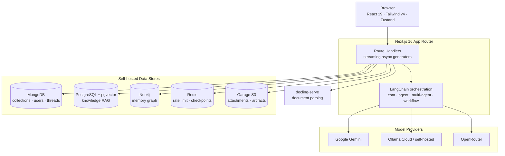

<div align="center">


# GenieChat

**One genie. Every wish.**

**Every model. Every tool. Every memory — one self-hosted platform.**

[](https://nextjs.org)
[](https://react.dev)
[](https://www.typescriptlang.org)
[](https://tailwindcss.com)
[](https://pnpm.io)
[](https://nodejs.org)
[](https://vitest.dev)
[](#contributing)

[Features](#features) · [Architecture](#architecture) · [Quick Start](#quick-start) · [Configuration](#configuration) · [Scripts](#scripts) · [Deployment](#deployment) · [Contributing](#contributing)

</div>

## About

**GenieChat** is a self-hosted AI workspace built on **Next.js 16 (App Router)**. It goes beyond a single chat window: it is a full environment for working with large language models — streaming multi-model conversations, configurable agents, multi-agent orchestration, MCP-powered tools, document knowledge bases, and a persistent memory graph.

It speaks to **three model providers** — Google Gemini, Ollama (Ollama Cloud by default, or your own daemon) and OpenRouter — behind one unified interface, so you can switch models mid-project without switching tools. Authentication is GitHub OAuth via NextAuth.js, and every byte of your data stays in infrastructure you run: MongoDB, PostgreSQL with pgvector, Neo4j, Redis and Garage object storage.

The application is designed for teams that need AI assistance without shipping their documents, conversations or credentials to a third-party SaaS.

> **Why "GenieChat"?** A genie is the one mythical figure whose whole character is *versatility* — it grants whatever you ask for, and every request is a different kind of thing. So does this one: models, agents, tools, documents, memory. **One genie. Every wish.**

## Table of Contents

- [Features](#features)
- [Architecture](#architecture)
- [Tech Stack](#tech-stack)
- [Quick Start](#quick-start)
- [Configuration](#configuration)
- [Local Services](#local-services)
- [Scripts](#scripts)
- [Supported Models](#supported-models)
- [Project Structure](#project-structure)
- [Testing & Quality](#testing--quality)
- [Deployment](#deployment)
- [Troubleshooting](#troubleshooting)
- [Contributing](#contributing)
- [Keywords](#keywords)
- [License](#license)

## Features

### 💬 Conversation

- **Multi-model chat** with streaming token-by-token responses and full Markdown rendering — GFM tables, math (KaTeX), Mermaid diagrams, syntax-highlighted code and scannable symbols (QR, Data Matrix, barcodes).
- **Model switching** at any point in a conversation, with per-model capability awareness (tools, reasoning, temperature).
- **Message versioning** — regenerate for a new answer without losing the old one, bounded by a configurable cap.
- **Chat documents** — attach files to a thread and retrieve over them with hybrid search.
- **Deep research** — an agentic research loop that produces a cited report, checkpointed through Redis.
- **Prompt library** — save, edit and reuse prompts, with an AI assist button for drafting.

### 🤖 Agents & Orchestration

- **Agents** — reusable assistants with their own system prompt, model, temperature, tools and knowledge documents.
- **Multi-agent** — a LangGraph supervisor routes work across specialist agents.
- **Swarm** — a lean, tool-less conversation surface rendered from the same conversation shell.
- **Auto** — automatic model routing for when you do not want to pick.

### 🛠️ Tools, Connectors & Automation

- **Connectors** — connect any **MCP (Model Context Protocol)** server and expose its tools to your models.
- **Custom tools** — define your own, with a fixed precedence between built-ins, connectors and user tools.
- **Webhooks** — invoke agents and workflows over HTTP.
- **Workflows** — compose multi-step automated pipelines.
- **Schedules** — cron or one-off triggers for workflows and agents, executed at-least-once with leases, retries and full run history.

### 🧠 Knowledge & Memory

- **Knowledge RAG** — agent and thread documents chunked, embedded and searched with **hybrid retrieval** (pgvector cosine + Postgres full-text, fused by Reciprocal Rank Fusion) on PostgreSQL + pgvector.
- **Memory graph** — long-term memories as a user-rooted, typed **fact graph** in **Neo4j**: `:Fact` triples over `:Entity`, `:Predicate` and `:Value` nodes, anchored on `:User`. A sentence is captured durably first and extracted later, facts are closed rather than deleted so a changed fact stays as dated history, and recall is a current-only, tenant-scoped vector seed plus a bounded traversal.
- **Workspace notes** — a rich-text BlockNote workspace alongside your conversations.

### 🔒 Platform

- **GitHub OAuth** authentication with role-based access control (`admin` / `manager` / `viewer`) resolved from allowlists.
- **Bring your own infrastructure** — MongoDB, PostgreSQL, Neo4j, Redis and Garage S3, all self-hosted.
- **Security headers** by default: CSP, HSTS, `X-Frame-Options`, `X-Content-Type-Options`, Referrer and Permissions policies.
- **Editorial monochrome design system** with light and dark themes.
- **Unit-tested pure logic** — Vitest across `lib/` and `constants/`, plus live-database check scripts.

## Architecture

A single Next.js application orchestrating purpose-built stores, each chosen for the shape of the data it holds.



**Design highlights**

| Concern | Approach |
| --- | --- |
| **Auth** | NextAuth.js (GitHub OAuth), JWT sessions, no provider token storage. Route protection in `proxy.ts` (Next.js 16's replacement for `middleware.ts`). |
| **Streaming** | API routes are async generators yielding typed events (`token`, `tool_start`, `tool_end`, …) consumed by surface-specific React hooks. |
| **Multi-tenancy** | Every user-scoped collection is filtered by `userId`; the Neo4j boundary is enforced inside every `MATCH` clause. |
| **Object storage** | Documents store canonical `s3://bucket/key` refs and presign a fresh URL on every read — no durable URL is ever persisted. |
| **Scheduling** | No in-app timer. An external cron calls `POST /api/schedules/tick`; runs hold leases, so a crash is a retry rather than a lost job. |
| **Pure/testable core** | Parsing, chunking, ranking, retry, cadence and layout logic lives in dependency-free modules with matching unit tests. |

## Tech Stack

| Layer | Technology |
| --- | --- |
| **Framework** | [Next.js 16](https://nextjs.org) (App Router, standalone output) |
| **UI** | [React 19](https://react.dev), [Tailwind CSS v4](https://tailwindcss.com), [Radix UI](https://www.radix-ui.com), [Lucide](https://lucide.dev), [Framer Motion](https://www.framer.com/motion/) |
| **Language** | [TypeScript 6](https://www.typescriptlang.org) |
| **LLM orchestration** | [LangChain](https://js.langchain.com), [LangGraph](https://langchain-ai.github.io/langgraphjs/), `@langchain/langgraph-supervisor`, `@langchain/mcp-adapters` |
| **State & data fetching** | [Zustand](https://zustand-demo.pmnd.rs), [TanStack React Query](https://tanstack.com/query) |
| **Rendering** | [react-markdown](https://github.com/remarkjs/react-markdown), [Mermaid](https://mermaid.js.org), [KaTeX](https://katex.org), [Recharts](https://recharts.org), [bwip-js](https://github.com/metafloor/bwip-js), [BlockNote](https://www.blocknotejs.org) |
| **Databases** | [MongoDB](https://www.mongodb.com) (driver), [PostgreSQL](https://www.postgresql.org) + [pgvector](https://github.com/pgvector/pgvector), [Neo4j](https://neo4j.com), [Redis](https://redis.io) |
| **Object storage** | [Garage](https://garagehq.deuxfleurs.fr) via the AWS S3 SDK |
| **Document parsing** | self-hosted [`docling-serve`](https://github.com/docling-project/docling-serve) |
| **Auth** | [NextAuth.js v4](https://next-auth.js.org) (GitHub provider) |
| **Validation & logging** | [Zod](https://zod.dev), [pino](https://getpino.io) |
| **Testing** | [Vitest](https://vitest.dev) |
| **Package manager** | [pnpm](https://pnpm.io) 11.1.2 (`node-linker=hoisted`) |

## Quick Start

### Prerequisites

- **Node.js ≥ 20**
- **pnpm 11.1.2** — `corepack enable`
- **Docker** (for local Redis, PostgreSQL, Neo4j and Garage)
- A **GitHub OAuth App** — [create one](https://github.com/settings/developers) with callback URL `http://localhost:3000/api/auth/callback/github`

### 1. Clone and install

```bash
git clone https://github.com/Sidharth-e/GenieChat.git
cd GenieChat
pnpm install
```

### 2. Configure the environment

```bash
cp .env.example .env
```

Fill in at minimum `MONGODB_URI`, `NEXTAUTH_SECRET`, `GITHUB_CLIENT_ID` and `GITHUB_CLIENT_SECRET`. See [Configuration](#configuration) for the full list.

### 3. Start the backing services

```bash
docker compose up -d
```

This brings up Redis, PostgreSQL + pgvector, Neo4j, Garage (with its bootstrap job), the `docling-serve` sidecar and a development tick sidecar.

### 4. Initialise the databases

```bash
pnpm db:setup        # MongoDB: collections + indexes (idempotent)
pnpm db:setup:pg     # PostgreSQL: pgvector table + indexes
pnpm db:setup:neo4j  # Neo4j: constraints + vector indexes
```

### 5. Run

```bash
pnpm dev
```

Open **[http://localhost:3000](http://localhost:3000)** and sign in with GitHub.

> **Windows note:** `output: "standalone"` requires symlink privileges. Enable Developer Mode or run your terminal as Administrator before `pnpm build`.

## Configuration

Every variable is defined and validated in [`lib/env.ts`](lib/env.ts) — the app fails fast on a missing required value. `.env.example` documents each one in full.

### Core

| Variable | Required | Description |
| --- | :---: | --- |
| `MONGODB_URI` | **Yes** | MongoDB connection string. Defaults to port **27018** locally. |
| `MONGODB_DB_NAME` | No | Database name. Defaults to `geniechat`. |
| `NEXTAUTH_SECRET` | **Prod** | Random string ≥ 32 chars for session signing. |
| `NEXTAUTH_URL` | No | Base URL of the app. |
| `GITHUB_CLIENT_ID` / `GITHUB_CLIENT_SECRET` | **Prod** | GitHub OAuth App credentials. |
| `GITHUB_ADMIN_USERNAMES` / `GITHUB_MANAGER_USERNAMES` / `GITHUB_VIEWER_USERNAMES` | No | Comma-separated GitHub logins mapped to roles. |
| `SECRET_ENCRYPTION_KEY` | **Prod** | Encrypts stored secrets. **Do not rotate once data exists.** |
| `CRON_SECRET` | **Prod** | Bearer token guarding the scheduling endpoints. |

### Providers

| Variable | Required | Description |
| --- | :---: | --- |
| `OLLAMA_BASE_URL` | No | Self-hosted Ollama daemon. Omit to use Ollama Cloud. |
| `OLLAMA_API_KEY` | For chat/embeddings | Key from [ollama.com](https://ollama.com/settings/keys). |
| `GOOGLE_API_KEY` | For Gemini | Enables the Google Gemini models. |
| `OPENROUTER_API_KEY` / `OPENROUTER_EMBEDDING_MODEL` | No | Enables routing through OpenRouter. |
| `EXA_API_KEY` | For web search | Powers web search and citations. |
| `DEEP_RESEARCH_MODEL` | No | Model override for the deep-research loop. |

### Data stores

| Variable | Required | Description |
| --- | :---: | --- |
| `POSTGRES_URL` | **Prod** | PostgreSQL + pgvector for knowledge RAG. |
| `NEO4J_URI` / `NEO4J_PASSWORD` | **Prod** | Neo4j for the memory graph. Blank disables memory gracefully. |
| `REDIS_URL` | **Prod** | One connection string for rate limiting and deep-research checkpoints. `rediss://` enables TLS. |
| `S3_ENDPOINT` / `S3_PUBLIC_ENDPOINT` / `S3_REGION` / `S3_ACCESS_KEY_ID` / `S3_SECRET_ACCESS_KEY` / `S3_FORCE_PATH_STYLE` | No | Garage object storage. `S3_PUBLIC_ENDPOINT` is the **browser-reachable** address. |
| `DOCLING_SERVE_URL` / `DOCLING_SERVE_API_KEY` / `DOCLING_SERVE_TIMEOUT_MS` | No | Document parsing sidecar. Unset degrades to no parsing rather than blocking boot. |

> **Warning:** never leave an optional URL variable blank (`VAR=`). An empty string fails URL validation at boot — omit the line instead.

## Local Services

`docker compose up -d` starts the complete local stack:

| Service | Image | Port | Purpose |
| --- | --- | --- | --- |
| `redis` | `redis:7-alpine` | 6379 | Rate limiting, research checkpoints |
| `postgres` | `pgvector/pgvector:pg17` | 5433 | Knowledge RAG vector store |
| `neo4j` | `neo4j:2026.08-community` | 7687 / 7474 | Memory graph |
| `garage` | `dxflrs/garage:v2.4.1` | 3900 | S3-compatible object storage |
| `garage-bootstrap` | local | — | Creates and grants the seven buckets |
| `docling` | local build | 5001 | Document parsing |
| `schedule-tick` | `curlimages/curl` | — | Calls `/api/schedules/tick` every minute |

Ports are chosen to avoid clashing with personal instances — MongoDB on `27018`, PostgreSQL on `5433`.

> `garage.toml` ships a **development-only** fixed `rpc_secret`. Any deployment beyond local development must generate its own.

## Scripts

| Command | Description |
| --- | --- |
| `pnpm dev` | Start the development server on port 3000 |
| `pnpm dev:secure` | Dev server with `NODE_TLS_REJECT_UNAUTHORIZED=0` |
| `pnpm build` | Production build (Next.js standalone output) |
| `pnpm start` | Serve the production build |
| `pnpm lint` | ESLint (`next/core-web-vitals` + TypeScript) |
| `pnpm type-check` | TypeScript type checking (`tsc --noEmit`) |
| `pnpm test` | Run the Vitest unit suite |
| `pnpm test:watch` | Vitest in watch mode |
| `pnpm test:coverage` | Vitest with coverage |
| `pnpm ci:check` | `type-check` + `lint` + `test` — the full gate |

### Database & diagnostics

| Command | Description |
| --- | --- |
| `pnpm db:setup` | Create MongoDB collections and indexes (idempotent) |
| `pnpm db:setup:pg` | Create the pgvector table and indexes |
| `pnpm db:setup:neo4j` | Create Neo4j constraints and memory vector indexes |
| `pnpm embeddings:check` | Exercise the Ollama embedding path (`scripts/check-embeddings.ts`) |
| `pnpm knowledge:check` | Exercise the knowledge store end to end |
| `pnpm knowledge:backfill` | Re-chunk and re-embed existing documents |
| `pnpm memory:check` | Exercise the fact graph: writes, recall, orphan GC, paging, statement syntax |
| `pnpm memory:eval` | Score recall against the fixed probe set |
| `pnpm memory:sweep` | Run one memory sweep pass (calls the running app's `CRON_SECRET` endpoint) |
| `pnpm memory:drop-prose` | One-off: drop every `:Memory` node and the index and constraint that served them |
| `pnpm schedules:check` | Exercise scheduling concurrency properties |
| `pnpm schedules:migrate` | Convert legacy workflow cron triggers into schedules |
| `pnpm storage:check` | Exercise the Garage S3 client |

## Supported Models

Model definitions live in [`lib/langchain/models/`](lib/langchain/models/) — one list per provider ([`google.ts`](lib/langchain/models/google.ts), [`ollama.ts`](lib/langchain/models/ollama.ts), [`openrouter.ts`](lib/langchain/models/openrouter.ts)), assembled into `AVAILABLE_MODELS` by [`index.ts`](lib/langchain/models/index.ts) and re-exported from [`lib/langchain/model-config.ts`](lib/langchain/model-config.ts).

| Provider | Models |
| --- | --- |
| **Google Gemini** | Gemini 3.8 Flash, 3.5 Flash / Flash-Lite, 3 Flash Preview, 3 / 3.1 Pro Preview, 2.5 Pro, 2.5 Flash |
| **Ollama** | DeepSeek v4.1 Flash & R1, Qwen 3.8 / 3.8 Flash Next, GLM 5.3 / 5.3 Flash, Kimi K3, Nemotron 3 Ultra / 3.5 Lightning, Minimax M3, GPT-OSS 120B, Gemma 4 |
| **OpenRouter** | Claude Opus 5.5 / Sonnet 5 / Fable 5.1, GPT-6 Astra / Sol Pro / Luna Pro, GPT-5.5 Pro, GLM 5.3 Prime / FlashX / Flash, Kimi K3, and a Jev Router auto-routing entry |

Embeddings run through Ollama and index at **2048 dimensions** ([`constants/embeddings.ts`](constants/embeddings.ts)) — this must match the configured embedding model's output width.

## Project Structure

```
GenieChat/
├── app/
│   ├── (rail)/          # App frame with the nav rail: chat, agents, tools, memories, schedules …
│   ├── (fullscreen)/    # Editor forms, edge to edge with no rail (agents, tools, connectors, webhooks, workflows, schedules)
│   ├── api/             # Route handlers — chat streaming, agents, workflows, arena, storage …
│   ├── login/           # GitHub sign-in
│   └── preview/         # Standalone views
├── components/          # UI — by feature (chat/, agents/, workflow/, ui/, common/, layout/)
├── constants/           # Config values and design tokens
├── hooks/               # React Query hooks and the conversation stream hooks
├── lib/
│   ├── api/             # Route-layer helpers (rate limiting, auth, cron guard)
│   ├── artifacts/       # Artifact writers
│   ├── auth/            # NextAuth config and role resolution
│   ├── docling/         # Document parsing
│   ├── embeddings/      # OpenRouter embeddings (knowledge RAG + memory graph)
│   ├── generation/      # OpenRouter image and video generation
│   ├── knowledge/       # RAG — chunking, ranking, indexing, search
│   ├── langchain/       # Model factory, chat/agent/multi-agent/workflow services
│   ├── memory/          # Neo4j memory graph, extraction, recall, view
│   ├── mongodb/         # MongoDB stores
│   ├── neo4j/           # Neo4j driver
│   ├── postgres/        # pgvector client
│   ├── schedules/       # Scheduling subsystem
│   ├── stores/          # Zustand stores
│   └── storage/         # Garage S3
├── scripts/             # Bootstrap and check scripts (tsx)
├── tests/               # Vitest unit tests (mirrors lib/)
├── proxy.ts             # Next.js 16 route protection (replaces middleware.ts)
└── docker-compose.yml   # Local backing services
```

**Conventions worth knowing**

- Pages **compose only** — components live in `components/`.
- Pure logic in `lib/` and `constants/` is **unit-tested**; anything requiring I/O is an integration test.
- Timestamps are stored as **ISO 8601 strings** (three TTL-backed fields excepted) so they sort chronologically.
- MongoDB `_id` is always a **uuidv7 string**, never an ObjectId.
- Colours come from **CSS custom properties** in `app/globals.css`, never raw Tailwind colour utilities.

## Testing & Quality

```bash
pnpm test          # Vitest unit suite (~68 test files)
pnpm type-check    # tsc --noEmit
pnpm lint          # ESLint
pnpm ci:check      # All three, in order
```

The suite concentrates on the logic that is expensive to get wrong and cheap to isolate: RRF fusion, text truncation, cadence computation, retry classification, graph layout, artifact parsing, ref formatting. Store-level behaviours that only a live database can prove are covered by the `*:check` scripts instead.

## Deployment

GenieChat builds to a Next.js **standalone** bundle (`output: "standalone"`).

Whatever hosts it must provide **every backing service** — the app hosts none of them itself:

- `REDIS_URL` — a reachable Redis
- `POSTGRES_URL` — a reachable PostgreSQL with pgvector
- `NEO4J_URI` + `NEO4J_PASSWORD` — a reachable Neo4j
- `S3_*` — Garage reachable by **both** the app and the browser (presigned URLs are fetched directly by the client)
- `DOCLING_SERVE_URL` — optional; unparsed documents surface an explicit notice in chat rather than failing silently

**Scheduled execution** is driven externally. Point a cron, container scheduler or serverless timer at `POST /api/schedules/tick` with the `CRON_SECRET` bearer token. The endpoint runs one tick and returns — the app never assumes a long-lived process. `/api/cron` does **not** exist; a deployment still calling it receives a silent 404 and its schedules stop firing.

## Troubleshooting

| Symptom | Likely cause |
| --- | --- |
| Boot fails validating an optional URL | A variable is present but blank (`VAR=`). Remove the line or set a real value. |
| Uploads fail with `NoSuchBucket` | A bucket was added after Garage last bootstrapped — re-run `docker compose up garage-bootstrap`. |
| Presigned URLs fail in the browser | `S3_PUBLIC_ENDPOINT` / `S3_REGION` mismatch: SigV4 signs the Host header, and the region must equal Garage's `s3_region`. |
| Every schedule tick returns 401 | The tick's `CRON_SECRET` differs from the app's. |
| Build fails on Windows with symlink errors | Enable Developer Mode or run as Administrator (standalone output uses symlinks). |
| Embedding errors after changing the model | `EMBEDDING_DIMENSIONS` no longer matches the model's output width. |

## Contributing

Contributions are welcome.

1. Fork the repo and create a branch: `git checkout -b feat/your-feature`
2. Follow the existing folder structure and conventions (see [Project Structure](#project-structure)).
3. Add unit tests for any pure logic you introduce.
4. Run the gate before opening a PR:

   ```bash
   pnpm ci:check
   ```

5. Open a pull request with a clear description of the change and its motivation.

Keep `CLAUDE.md` current when you change architecture, conventions, dependencies or environment variables — stale docs are worse than none.

## Keywords

`self-hosted AI workspace` · `multi-model LLM chat` · `Next.js 16` · `React 19` · `TypeScript` · `Tailwind CSS v4` · `LangChain` · `LangGraph` · `multi-agent orchestration` · `AI agents` · `MCP` · `Model Context Protocol` · `RAG` · `retrieval-augmented generation` · `pgvector` · `hybrid search` · `reciprocal rank fusion` · `Neo4j` · `knowledge graph` · `graph memory` · `Ollama` · `Google Gemini` · `OpenRouter` · `MongoDB` · `PostgreSQL` · `Redis` · `Garage S3` · `self-hosted` · `GitHub OAuth` · `workflow automation` · `document parsing` · `docling`

> **Maintainers:** set these as your repository **Topics** (Settings → Topics) so the project is discoverable — `ai-chat`, `nextjs`, `langchain`, `langgraph`, `rag`, `pgvector`, `neo4j`, `ollama`, `multi-agent`, `mcp`, `self-hosted`, `typescript`.

## License

GenieChat is released under the [**MIT License**](LICENSE).

You are free to use, copy, modify, merge, publish, distribute, sublicense and sell it — the only requirement is that you keep the copyright notice and this permission notice. The software is provided *"as is"*, without warranty of any kind.

Copyright © 2026 Sidharth E.

<div align="center">


**GenieChat** — one genie. Every wish.

Built with [Next.js](https://nextjs.org) · [LangChain](https://js.langchain.com) · [Neo4j](https://neo4j.com) · [pgvector](https://github.com/pgvector/pgvector)

</div>
